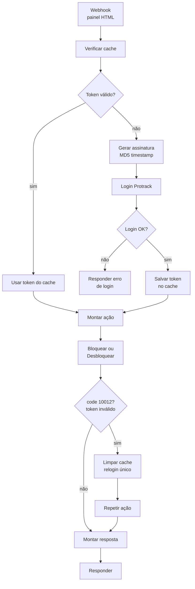

# n8n-protrack-token-cache

Fluxo n8n que bloqueia e desbloqueia contas numa plataforma de rastreamento
veicular (Protrack), com **cache de token, relogin automático e erro traduzido
para quem está do outro lado da tela**.

27 nós. Painel HTML servido pelo próprio fluxo, três webhooks e um ciclo de
retry completo.

## O problema

A API da Protrack autentica por assinatura MD5 com timestamp e devolve um
`access_token`. Fazer login a cada operação é lento e esbarra no limite de
requisições por segundo da plataforma.

Mas guardar o token também tem armadilha: um login feito em outro lugar
**invalida o token guardado**, e a API devolve `10012` sem avisar o porquê.

## O caminho dos dados



## Decisões que sustentam o fluxo

**Cache com validade menor que a do token.** O token dura mais que a janela
usada no cache. A margem evita o caso em que o token expira entre a verificação
e a chamada — o clássico TOCTOU aplicado a autenticação.

**Relogin acontece uma vez só.** Quando a API devolve `10012`, o fluxo limpa o
cache, faz um único relogin e repete a ação. Sem esse limite, um token
permanentemente inválido viraria laço infinito de login — e a conta levaria
bloqueio por excesso de tentativa.

**Cada código de erro vira uma frase que a pessoa entende.** A Protrack responde
com número. O fluxo traduz:

| Código | Mensagem devolvida |
|---|---|
| `0` | Operação realizada com sucesso |
| `10007` | Conta não encontrada — o identificador pode não ser o CPF |
| `10009` | Limite de requisições excedido, aguarde alguns segundos |
| `10012` | Token inválido ou expirado |
| timeout | A Protrack demorou demais, tente novamente |

Quem usa o painel não é desenvolvedor. `{"code":10007}` não ajuda ninguém;
"confira o usuário customizado" resolve o atendimento sem abrir chamado.

**Timeout é tratado como caso previsto.** A diferença entre "a plataforma
demorou" e "a operação falhou" muda o que a pessoa faz em seguida: na primeira
ela tenta de novo, na segunda ela investiga.

## O que foi retirado desta versão pública

**As credenciais estavam hardcoded num Code node** — conta e senha em texto
puro, repetidas em dois nós. Nesta versão viraram variáveis de ambiente:

```js
const account  = $env.PROTRACK_ACCOUNT;
const password = $env.PROTRACK_PASSWORD;
```

É como deveria ser desde o início. Credencial em Code node aparece no export,
no log de execução e para qualquer pessoa com acesso ao n8n.

Também saíram: URL da instância, IDs de credencial e de webhook, e os
identificadores da empresa.

## Como usar

1. n8n → **Import from File** → `workflow.json`
2. Defina `PROTRACK_ACCOUNT` e `PROTRACK_PASSWORD` como variáveis de ambiente
3. Troque os três `webhookId` por IDs seus
4. Ajuste a URL base da API Protrack

## Nota sobre `$getWorkflowStaticData`

O cache usa `$getWorkflowStaticData('global')`, que só funciona dentro de um
Code node. Numa expressão de nó `IF` ele retorna `undefined` em silêncio e a
condição nunca bate — por isso a verificação do cache é um Code node, não uma
expressão.

## Stack

n8n · API REST · autenticação por assinatura MD5 · HTML

## Licença

MIT
